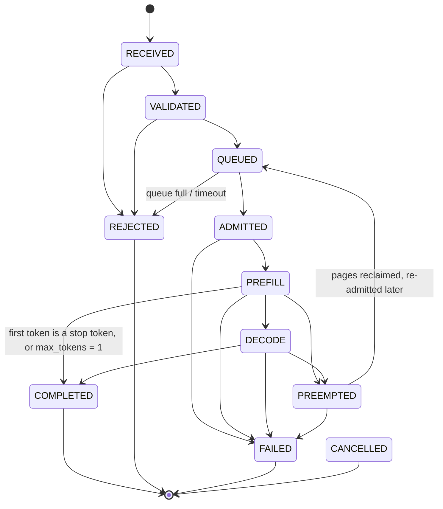

# Request lifecycle

Every request the scheduler handles is a `neuroserve::core::Request`
(`runtime/core/include/neuroserve/core/request.hpp`). Any transition not shown here throws
`IllegalTransition` and leaves the request unchanged.

Every non-terminal state can also move to `CANCELLED` (client cancelled or disconnected);
those edges are left out of the diagram for readability.

| Terminal state | Meaning for the client |
| --- | --- |
| `COMPLETED` | Finished: stop token or `max_tokens` |
| `REJECTED` | Never ran on the GPU: safe to retry |
| `FAILED` | Error while running |
| `CANCELLED` | Cancelled by the client |

## Design decisions

- **Prefill can complete directly**: prefill emits the first token, which may end the request.
- **A preempted request re-enters `QUEUED`**, not `ADMITTED`: it lost its KV pages and must not
  skip requests already waiting.
- **Decoding another token is not a transition**: per-token progress is counted, not logged as
  state changes.
- **Timestamps use `steady_clock`** (never jumps backwards) and record the *first* entry into
  each state, so queue wait counts from the first `QUEUED`; preemptions are counted.
- **Ids**: `ns-000001`, … from an atomic counter, process-unique and ordered by arrival. They are
  internal scheduler ids, distinct from the client-facing `X-Request-ID`.
- **Thread safety**: a `Request` is changed only by the engine thread; only the id counter is
  shared.
